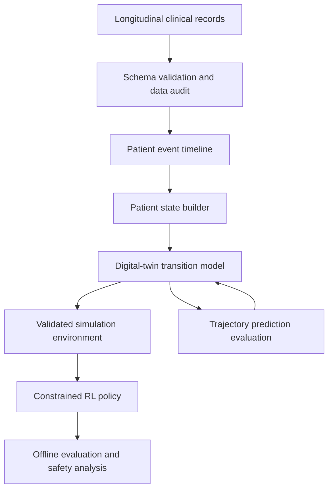

# Project Architecture and Methodology

**Project:** LLM-Based Patient Digital Twin with Reinforcement Learning for Treatment Optimization  
**Document status:** Working design, version 0.1  
**Last updated:** 2026-10-18

## 1. What are we building?

The project investigates whether a patient-specific digital twin can model how a patient's clinical state evolves over time, and whether a reinforcement-learning (RL) policy can use that simulator to compare treatment decisions. The intended research contribution is to move beyond forecasting a patient's next state toward carefully evaluated, action-conditioned treatment simulation and decision support.

This is a research prototype, not a clinical tool. It must not be used to recommend treatment to real patients.

## 2. The two main components

### A. Patient digital twin

A digital twin is a computational model of a patient's evolving clinical state. At time \(t\), it receives a representation of the observed patient history and predicts a future state or trajectory. The representation should preserve the time of observations, treatment history, and missingness.

A generic transition target is:

`predicted_next_state = twin(current_state, treatment_action, elapsed_time)`

The action must be explicit in the model input if the model is intended to compare treatments. A model that predicts outcomes from history alone is a forecasting model; it does not, by itself, establish what would happen under a different treatment.

### B. RL treatment policy

An RL policy observes a state and proposes an action. The environment uses the digital twin to simulate a next state and calculates a reward. In a future stage, the policy may be trained offline or in a validated simulator, with strict action constraints and evaluation against held-out patients.

The RL environment is **not implemented yet**. State, action, reward, episode termination, and safety constraints must be defined and justified before training.

## 3. Current data status and scope

The JSON currently analysed is `clinical.project-tcga-ov.2026-10-09.json`, a TCGA-OV ovarian-cancer cohort export. The file contains 608 case records. The analysis found diagnosis records, nested treatment records, follow-up records, demographic data, and pathology details.

This is not MIMIC-IV. Earlier project discussions identified MIMIC-IV as a possible primary dataset, so the repository must explicitly record this change in dataset scope. TCGA-OV is useful for exploring ovarian-cancer diagnosis, treatment, recurrence, response, and survival trajectories, but it does not provide the dense repeated vital-sign and laboratory time series typically needed for an ICU-style physiological twin.

**Current decision:** use TCGA-OV for data inspection and a first trajectory-preprocessing prototype. Do not claim it is sufficient for treatment optimization until the number and quality of usable state–action–next-state transitions have been measured.

## 4. Current pipeline

1. **Raw data:** keep the source JSON unchanged in a local/raw-data location; do not commit restricted or large source data unless its licence and sharing rules allow it.
2. **Schema and data audit:** document fields, nesting, availability, missingness, units, and time conventions.
3. **Event extraction:** convert diagnoses, treatments, and follow-ups into a patient-level event table, retaining original relative-day fields and source record identifiers.
4. **Chronological patient representation:** construct the state at each decision time from information available up to that time only. Do not leak future outcomes into earlier states.
5. **Transition dataset:** create candidate tuples `(state_t, action_t, elapsed_time, next_state, outcome)` only where timing and linkage are defensible.
6. **Digital-twin baseline:** first train/evaluate a structured-data baseline for next-event or outcome prediction. Add an LLM only when its role and value can be tested.
7. **Simulator validation:** compare predicted trajectories with held-out observed trajectories; assess calibration, subgroup performance, uncertainty, and failure cases.
8. **RL formulation:** only after validation, define action space, reward, episode end, safety constraints, and offline evaluation.
9. **Evaluation and reporting:** split at the patient level, report limitations, and prevent the same patient from appearing across train/validation/test partitions.

## 5. Proposed conceptual architecture

This is a conceptual pipeline, not a claim that all components have been implemented.

## 6. Design principles

- **Temporal correctness:** never use information recorded after decision time to build the current state.
- **Patient-level separation:** train/validation/test splits are made by patient, not by individual events.
- **Missingness is information:** distinguish absent fields, explicit `Unknown`/`Not Reported` values, and genuinely negative findings.
- **Units are not interchangeable:** dose values must be interpreted together with their units; do not compare mg, mg/m², AUC, and cGy as if equivalent.
- **Prediction is not causation:** observational treatment/outcome associations do not prove treatment effects.
- **Uncertainty and safety:** a simulator should expose uncertainty and constrain actions to defensible, dataset-supported choices.
- **Reproducibility:** scripts, configuration, data dictionaries, and decision changes are versioned; restricted raw data is not committed.
- **Incremental complexity:** establish a transparent structured baseline before adding an LLM or RL.

## 7. What this dataset can and cannot currently support

### Potentially supported
- Patient-level diagnosis and disease characteristics.
- Treatment history at a relatively coarse clinical-event level.
- Follow-up response, recurrence/progression indicators, performance status, and survival fields where present.
- Retrospective trajectory description and selected outcome-prediction tasks.

### Not established yet
- Dense day-by-day physiology or laboratory trajectories.
- Reliable outcomes for every treatment event.
- A causal estimate of what would have happened under an alternative treatment.
- A clinically valid reward function or safe treatment action space.
- Sufficient evidence to train a trustworthy treatment-optimizing RL agent.

## 8. Immediate next steps

1. Review `docs/data/patient_state_schema.md` and `docs/data/dataset_to_state_mapping.csv`.
2. Run `scripts/preprocess_tcga_ov.py` on the source JSON and inspect its output.
3. Audit event ordering, relative-day semantics, missingness, and the treatment-to-follow-up linkage.
4. Decide the narrow clinical question and prediction horizon.
5. Only then design and evaluate the first digital-twin baseline.

## 9. How to maintain this document

Whenever a design choice changes, update `docs/architecture/DECISION_LOG.md` with the date, context, decision, alternatives, rationale, evidence, risks, and follow-up test. Keep this architecture document as the current overview; put detailed chronological decisions in the log.
