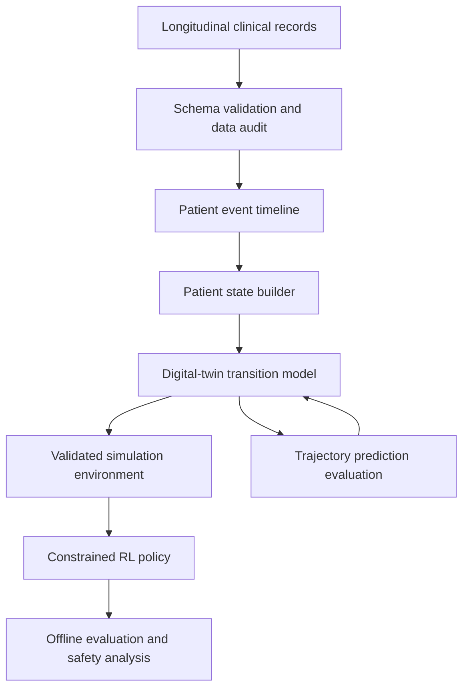

# Project Architecture and Methodology

**Project:** Transformer Patient Digital Twin and Offline RL for Ovarian Cancer
**Document status:** Current working architecture, version 0.6
**Last updated:** 2026-10-29

## 1. What are we building?

The project adapts the base paper's three-stage workflow: (1) a causal Transformer ensemble forecasts next recorded patient states, (2) an outcome/reward model, and (3) BCQ offline RL. Stage 1 is implemented and trained. The Transformer-backed environment wrapper passes a 5-episode/15-step software smoke run, but all 15 rewards were unavailable because predicted tumor status was missing. Stages 2 and 3 are not implemented or validated.

This is a research prototype, not a clinical tool. It must not be used to recommend treatment to real patients.

## 2. The paper's method and the local implementation

### A. Digital twin (Transformer dynamics model implemented and trained)

A digital twin is a computational model of a patient's evolving clinical state. At time \(t\), it receives a representation of the observed patient history and predicts a future state or trajectory. The representation should preserve the time of observations, treatment history, and missingness.

A generic transition target is:

`predicted_next_state = twin(current_state, treatment_action, elapsed_time)`

The action must be explicit in the model input if the model is intended to compare treatments. A model that predicts outcomes from history alone is a forecasting model; it does not, by itself, establish what would happen under a different treatment.

The paper uses a five-member Transformer ensemble, an adversarially trained outcome/reward model, and ensemble disagreement for uncertainty. `scripts/transformer_digital_twin.py` implements the Stage 1 ensemble; its local target is the next recorded mapped treatment-decision state. It is trained, but tumor status is known for only 13 held-out targets, all with tumor. `scripts/llm_twin_rl.py` is a historical experiment, not the selected twin.

### B. Offline RL policy (planned)

An RL policy observes a state and proposes an action. The environment uses the digital twin to simulate a next state and calculates a reward. In a future stage, the policy may be trained offline or in a validated simulator, with strict action constraints and evaluation against held-out patients.

The paper uses BCQ to constrain choices to actions supported by historical treatment data. `scripts/transformer_twin_rl_environment.py` wraps the frozen dynamics model in a Gym-like `reset()`/`step()` interface and restricts actions to combinations observed in training. It is an integration sandbox; it does not train BCQ or any RL policy. The v2 smoke report has 15/15 unavailable rewards because tumor response is missing. A rollout is a model-generated hypothesis, not observed clinical evidence.

### C. Current data preparation (implemented)

`scripts/paper_method_pipeline.py` normalizes the 587 diagnosis-indexed cases, builds an inspectable treatment-class mapping, patient-level splits, same-day action sets, paper-style pre-action features, and candidate later-response links. Link-quality labels preserve uncertainty caused by missing dates and intervening actions. See `PAPER_METHOD_REPLICATION.md` for exact field rules and results.

The earlier scripts `preprocess_tcga_ov.py` and `patient_twin.py` create a general event table and retrospective patient summaries. `evaluate_trajectory_baseline.py` evaluates next-observed-response forecasting. These remain useful legacy/exploratory work, but they are not the paper's action-conditioned digital twin. `compare_llm_trajectory.py` is an optional LLM forecast adapter, not the paper's transition model.

## 3. Current data status and scope

The JSON currently analysed is `clinical.project-tcga-ov.2026-10-09.json`, a TCGA-OV ovarian-cancer cohort export. The file contains 608 case records. The analysis found diagnosis records, nested treatment records, follow-up records, demographic data, and pathology details.

This is not MIMIC-IV. Earlier project discussions identified MIMIC-IV as a possible primary dataset, so the repository must explicitly record this change in dataset scope. TCGA-OV is useful for exploring ovarian-cancer diagnosis, treatment, recurrence, response, and survival trajectories, but it does not provide the dense repeated vital-sign and laboratory time series typically needed for an ICU-style physiological twin.

**Current decision:** use TCGA-OV for a retrospective next-recorded-state forecasting prototype. Measured transition counts and label coverage show that the export is not sufficient for treatment optimization or causal action comparisons.

## 4. Target pipeline and current stage

1. **Source and audit:** preserve the source export; document the field structure, missingness, units, and time origin.
2. **Paper-style preprocessing (implemented):** run `paper_method_pipeline.py`; inspect mapping and candidate tables, not just summary counts.
3. **Resolve data mismatch (open):** the export has 4,125 treatment records while the paper reports 2,552; the local normalization yields 51 combinations versus 47. Do not tune filters to match without evidence.
4. **Validate decision-time transitions (open):** verify event timing, parent linkage, state availability, action definitions, and outcome horizon. The candidate CSV is not automatically a training table.
5. **Train/evaluate the Transformer twin (initial run complete):** the saved held-out report compares per-feature forecasts with persistence. Tumor status has 13 known test targets, all with tumor; broad response performance is not established. A successful next-state forecast still would not validate counterfactual treatment effects.
6. **Offline RL (formulation/baselines present, optimization not implemented):** the MDP, reward proxy, episode termination, action-support constraints, and behavioral baselines are in `OBJECTIVES_2_3.md`; policy training and independent off-policy evaluation require a validated transition dataset and simulator.
7. **Explanation/reporting layer (optional future work):** an LLM can explain outputs, but must not substitute for the action-conditioned model or invent outcomes.

## 5. Proposed conceptual architecture

This is a conceptual pipeline, not a claim that all components have been implemented.

## 6. Design principles

- **Temporal correctness:** never use information recorded after decision time to build the current state.
- **Patient-level separation:** train/validation/test splits are made by patient, not by individual events.
- **Missingness is information:** distinguish absent fields, explicit `Unknown`/`Not Reported` values, and genuinely negative findings.
- **Units are not interchangeable:** dose values must be interpreted together with their units; do not compare mg, mg/m², AUC, and cGy as if equivalent.
- **Prediction is not causation:** observational treatment/outcome associations do not prove treatment effects.
- **Uncertainty and safety:** a simulator should expose uncertainty and constrain actions to defensible, dataset-supported choices.
- **Reproducibility:** scripts, configuration, data dictionaries, and decision changes are versioned; restricted raw data is not committed.
- **Incremental complexity:** establish a transparent structured baseline before adding an LLM or RL.

## 7. What this dataset can and cannot currently support

### Potentially supported
- Patient-level diagnosis and disease characteristics.
- Treatment history at a relatively coarse clinical-event level.
- Follow-up response, recurrence/progression indicators, performance status, and survival fields where present.
- Retrospective trajectory description and selected outcome-prediction tasks.

### Not established yet
- Dense day-by-day physiology or laboratory trajectories.
- Reliable outcomes for every treatment event.
- A causal estimate of what would have happened under an alternative treatment.
- A clinically valid reward function or safe treatment action space.
- Sufficient evidence to train a trustworthy treatment-optimizing RL agent.

## 8. Immediate next steps

1. Keep the current smoke report as evidence that model/environment integration runs, and do not treat its zero available rewards as a policy result.
2. Improve or replace the outcome target so it has observed, temporally linked tumor-response labels with adequate class support; the current held-out response subset has 13 known labels, all `WT-With Tumor`.
3. Obtain domain review for reward, action definitions, and safety constraints; the current 11-class action support is a frequency filter, not a safety screen.
4. Only after outcome and transition validation, implement the paper's outcome/reward model and BCQ with held-out/off-policy evaluation. Current data do not meet that gate.

## 9. How to maintain this document

Whenever a design choice changes, update `docs/architecture/DECISION_LOG.md` with the date, context, decision, alternatives, rationale, evidence, risks, and follow-up test. Keep this architecture document as the current overview; put detailed chronological decisions in the log.
