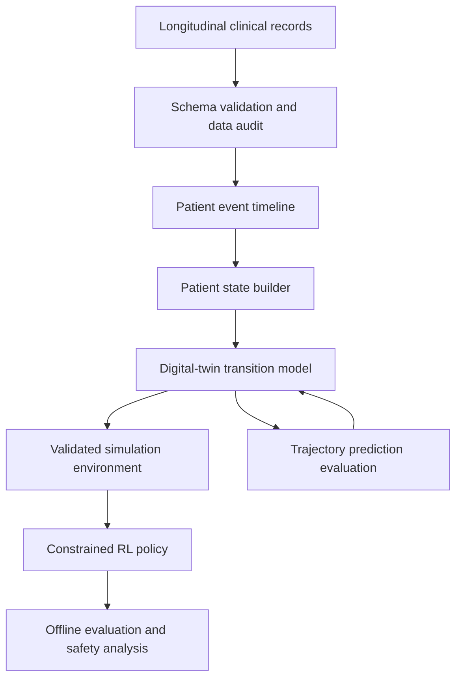

# Project Architecture and Methodology

**Project:** LLM-Based Patient Digital Twin with Reinforcement Learning for Treatment Optimization  
**Document status:** Paper-aligned working architecture, version 0.3  
**Last updated:** 2026-10-27

## 1. What are we building?

The target method follows the base paper: represent patient history and treatment actions, learn a next-state/outcome simulator, and evaluate a constrained offline-RL policy inside that simulator. The repository is at the **data-preparation stage**. It has not trained the paper's models or established treatment effects.

This is a research prototype, not a clinical tool. It must not be used to recommend treatment to real patients.

## 2. The paper's method and the local implementation

### A. Learned digital twin (planned)

A digital twin is a computational model of a patient's evolving clinical state. At time \(t\), it receives a representation of the observed patient history and predicts a future state or trajectory. The representation should preserve the time of observations, treatment history, and missingness.

A generic transition target is:

`predicted_next_state = twin(current_state, treatment_action, elapsed_time)`

The action must be explicit in the model input if the model is intended to compare treatments. A model that predicts outcomes from history alone is a forecasting model; it does not, by itself, establish what would happen under a different treatment.

The paper uses a Transformer ensemble to predict next state from a sequence of prior states and treatment actions. It also describes an adversarially trained treatment-outcome/reward model and ensemble disagreement for uncertainty. These models are not present in the current repository.

### B. Offline RL policy (planned)

An RL policy observes a state and proposes an action. The environment uses the digital twin to simulate a next state and calculates a reward. In a future stage, the policy may be trained offline or in a validated simulator, with strict action constraints and evaluation against held-out patients.

The paper uses BCQ to constrain choices to actions supported by historical treatment data. A simulator rollout is a model-based estimate, not observed clinical evidence. The RL environment and policy are **not implemented** here.

### C. Current data preparation (implemented)

`scripts/paper_method_pipeline.py` normalizes the 587 diagnosis-indexed cases, builds an inspectable treatment-class mapping, patient-level splits, same-day action sets, paper-style pre-action features, and candidate later-response links. Link-quality labels preserve uncertainty caused by missing dates and intervening actions. See `PAPER_METHOD_REPLICATION.md` for exact field rules and results.

The earlier scripts `preprocess_tcga_ov.py` and `patient_twin.py` create a general event table and retrospective patient summaries. `evaluate_trajectory_baseline.py` evaluates next-observed-response forecasting. These remain useful legacy/exploratory work, but they are not the paper's action-conditioned digital twin. `compare_llm_trajectory.py` is an optional LLM forecast adapter, not the paper's transition model.

## 3. Current data status and scope

The JSON currently analysed is `clinical.project-tcga-ov.2026-10-09.json`, a TCGA-OV ovarian-cancer cohort export. The file contains 608 case records. The analysis found diagnosis records, nested treatment records, follow-up records, demographic data, and pathology details.

This is not MIMIC-IV. Earlier project discussions identified MIMIC-IV as a possible primary dataset, so the repository must explicitly record this change in dataset scope. TCGA-OV is useful for exploring ovarian-cancer diagnosis, treatment, recurrence, response, and survival trajectories, but it does not provide the dense repeated vital-sign and laboratory time series typically needed for an ICU-style physiological twin.

**Current decision:** use TCGA-OV for data inspection and a first trajectory-preprocessing prototype. Do not claim it is sufficient for treatment optimization until the number and quality of usable state–action–next-state transitions have been measured.

## 4. Target pipeline and current stage

1. **Source and audit:** preserve the source export; document the field structure, missingness, units, and time origin.
2. **Paper-style preprocessing (implemented):** run `paper_method_pipeline.py`; inspect mapping and candidate tables, not just summary counts.
3. **Resolve data mismatch (open):** the export has 4,125 treatment records while the paper reports 2,552; the local normalization yields 51 combinations versus 47. Do not tune filters to match without evidence.
4. **Validate decision-time transitions (open):** verify event timing, parent linkage, state availability, action definitions, and outcome horizon. The candidate CSV is not automatically a training table.
5. **Train and validate the simulator (not implemented):** reproduce the dynamics ensemble and outcome model, compare held-out patients, and assess calibration and uncertainty.
6. **Define and evaluate offline RL (not implemented):** after simulator validation, define supported actions, reward, episode termination, safety constraints, and off-policy evaluation; then implement BCQ and baselines.
7. **Explanation/reporting layer (optional future work):** an LLM can explain outputs, but must not substitute for the action-conditioned model or invent outcomes.

## 5. Proposed conceptual architecture

This is a conceptual pipeline, not a claim that all components have been implemented.

## 6. Design principles

- **Temporal correctness:** never use information recorded after decision time to build the current state.
- **Patient-level separation:** train/validation/test splits are made by patient, not by individual events.
- **Missingness is information:** distinguish absent fields, explicit `Unknown`/`Not Reported` values, and genuinely negative findings.
- **Units are not interchangeable:** dose values must be interpreted together with their units; do not compare mg, mg/m², AUC, and cGy as if equivalent.
- **Prediction is not causation:** observational treatment/outcome associations do not prove treatment effects.
- **Uncertainty and safety:** a simulator should expose uncertainty and constrain actions to defensible, dataset-supported choices.
- **Reproducibility:** scripts, configuration, data dictionaries, and decision changes are versioned; restricted raw data is not committed.
- **Incremental complexity:** establish a transparent structured baseline before adding an LLM or RL.

## 7. What this dataset can and cannot currently support

### Potentially supported
- Patient-level diagnosis and disease characteristics.
- Treatment history at a relatively coarse clinical-event level.
- Follow-up response, recurrence/progression indicators, performance status, and survival fields where present.
- Retrospective trajectory description and selected outcome-prediction tasks.

### Not established yet
- Dense day-by-day physiology or laboratory trajectories.
- Reliable outcomes for every treatment event.
- A causal estimate of what would have happened under an alternative treatment.
- A clinically valid reward function or safe treatment action space.
- Sufficient evidence to train a trustworthy treatment-optimizing RL agent.

## 8. Immediate next steps

1. Reconcile the 4,125 versus 2,552 event counts and 51 versus 47 action combinations using paper/source preprocessing details.
2. Inspect `treatment_class_mapping.csv` and manually review the 1,449 fully mapped same-day action sets and linkage flags.
3. Establish whether treatment start/end dates and parent diagnosis links are complete enough for the paper's state-action-outcome rows. In the conservative full-history check, only 2 response links remain.
4. If evidence resolves these gates, define a reproducible transition dataset and implement/evaluate the digital twin. Otherwise, state clearly that this export supports retrospective response forecasting but not treatment optimization.

## 9. How to maintain this document

Whenever a design choice changes, update `docs/architecture/DECISION_LOG.md` with the date, context, decision, alternatives, rationale, evidence, risks, and follow-up test. Keep this architecture document as the current overview; put detailed chronological decisions in the log.
